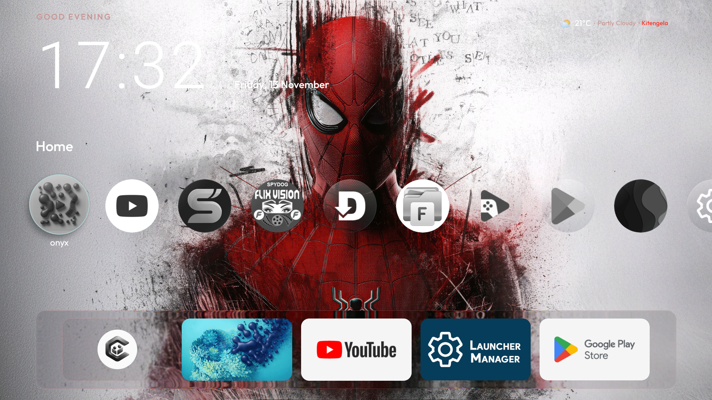
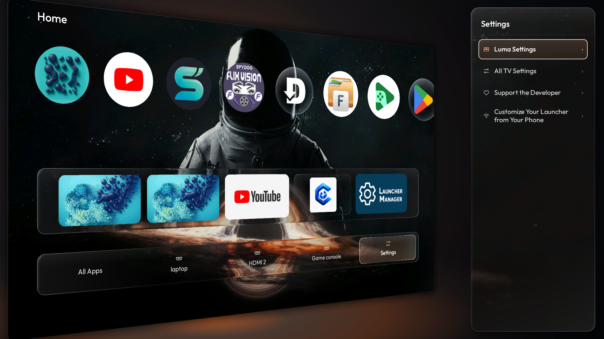
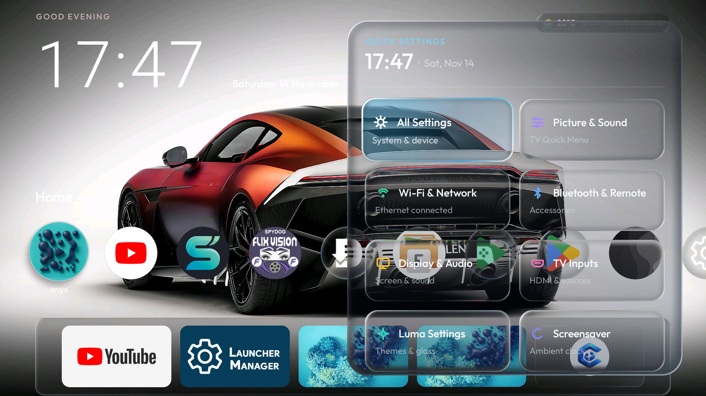
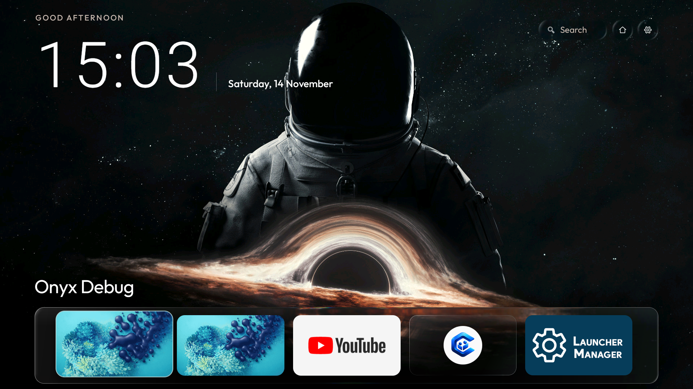
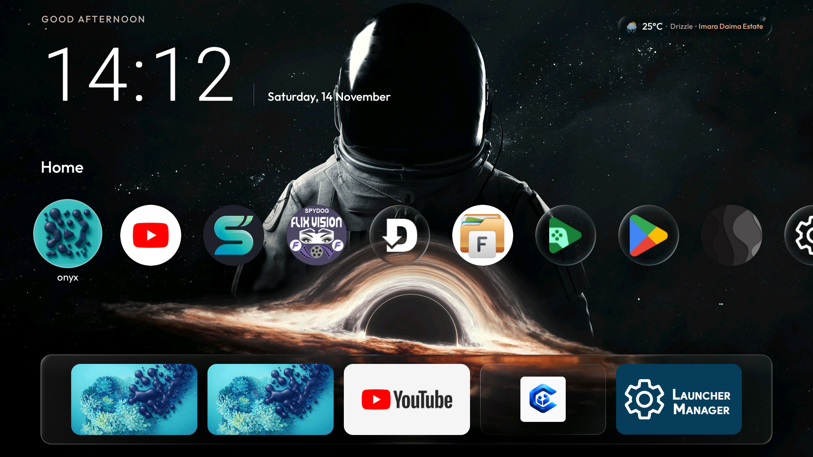

<div align="center">

# Luma Home

### *A little more you. A lot less noise.*

A modern, fluid, and privacy-first home screen launcher crafted specifically for **Android TV** and **Google TV**.

[](https://play.google.com/store/apps/details?id=com.lumahome.launcher&pli=1)
[](https://developer.android.com/tv)
[-007ACC?style=for-the-badge)](https://developer.android.com)
[](https://lumahome.zadhron.com/privacy)

---



</div>

---

## ✨ Overview

**Luma Home** reimagines the living-room TV interface. Unlike cluttered stock smart-TV dashboards filled with sponsored banner ads, unskippable promos, and heavy telemetry, Luma Home focuses entirely on elegance, speed, and personal control.

Every surface is rendered with a native GPU **Liquid Glass** shader engine, complete with live backdrop refraction, specular caustics, and adaptive circadian color extraction from your chosen wallpapers.

---

## 📸 Interface & Features

<div align="center">

### Spatial 3D Perspective Blades & System Overlays

| 3D Perspective Settings Blade | Floating Quick Settings Overlay |
| :---: | :---: |
|  |  |
| *Home screen smoothly rotates into 3D door perspective while settings slide in.* | *System-wide frosted glass overlay accessible over any running TV application.* |

| Full App Drawer & Recents Dock | Refracted Glass Bevels & Optics |
| :---: | :---: |
|  |  |
| *16:9 proportioned recent cards and full grid organization.* | *Real-time backdrop refraction, specular highlights, and magnifying focus lenses.* |

</div>

---

## 🌟 Key Highlights

### 🪟 Liquid Glass Surface Engine
* **Real-Time Dynamic Refraction:** Surface panels and floating lenses sample and refract live backdrop shifts in real time.
* **Frosted Glass Depth:** Adjustable blur depth (from crystal clear to deep frosted diffusion) with specular sheen levels (*None*, *Subtle*, *Balanced*, *Bright*).
* **Atmospheric Room Bloom:** Stationary radial underglows and ambient atmospheric lighting that harmoniously bleed into the room.

### 📐 3D Perspective Stage Transformation
* Opening menus or settings triggers a cinematic camera pivot, rotating the home screen into a 3D perspective door while translucent glass blade panels float into view.
* Completely responsive remote DPAD navigation with spatial audio feedback.

### 📱 Phone Studio (No App Required)
* Scan an on-screen QR code with any smartphone to open **Phone Studio** in your browser.
* Customize scenes, upload high-res wallpapers, reorder favorite app tiles, and adjust glass blur settings live over local Wi-Fi.

### ⚡ 16:9 Proportion-Locked Recents Dock
* Automatically tracks recent apps with strict 16:9 banner card aspect ratio bounding and symmetrical centering.
* Eliminates awkward card stretching or horizontal distortion.

### 🎛️ System-Wide Quick Settings Overlay
* Backed by `QuickSettingsOverlayService` to intercept remote hardware buttons (Settings/Menu keys).
* Brings up an ambient frosted-glass quick menu over running streaming apps (Netflix, YouTube, HDMI inputs, Prime Video) without terminating active playback.
* Features a transparent in-app prominent disclosure dialog ensuring 100% compliance with Google Play Accessibility policies.

### 🛡️ 100% Private & Ad-Free
* Zero telemetry, zero analytics SDKs, zero background trackers, and zero sponsored advertisements.
* Operates entirely on-device and respects local storage.

---

## 🛠️ Project Architecture

```
luma-home/
├── AndroidManifest.xml             # Declares Leanback launcher, services & permissions
├── build.py                        # Standalone build orchestrator (AAPT2, D8, bundletool)
├── release/                        # Release deliverables
│   ├── luma-home.aab               # Signed Android App Bundle for Google Play Store
│   ├── luma_accessibility_demo.mp4 # Video walkthrough for Google Play review
│   └── screenshots/                # Real-hardware 4K/1080p TV capture screenshots
├── src/com/lumahome/launcher/      # Core Application Source
│   ├── MainActivity.java           # Primary launcher orchestrator & 3D home stage
│   ├── QuickSettingsOverlayService.java # Hardware key filter & system-wide overlay
│   ├── PhoneDropServer.java        # Embedded HTTP web server for mobile QR studio
│   ├── BillingManager.java         # Google Play Billing Library v8 for voluntary tipping
│   ├── UiSoundEngine.java          # Spatial sound synthesis & navigation audio feedback
│   ├── IconStylingEngine.java      # Dynamic icon masks, specular shaders & optics
│   ├── AppCatalog.java             # Leanback package indexing & app categorization
│   ├── LauncherStore.java          # Thread-safe persistent preference store
│   └── ImageLoader.java            # Memory-conscious TV bitmap cache & scaler
└── website/                        # Official Next.js product & legal website
    ├── app/
    │   ├── page.tsx                # Interactive web landing page & TV simulator
    │   ├── privacy/page.tsx        # Hosted privacy policy
    │   ├── terms/page.tsx          # Hosted terms of service
    │   └── support/page.tsx        # Public support & contact portal
    └── lib/site.ts                 # Site metadata & branding configuration
```

---

## 🚀 Building & Development

### Prerequisites
* **Java Development Kit (JDK):** Version 17 or higher
* **Android SDK:** Build-Tools 34.0.0, Platform API 34
* **Python:** 3.8+ (for running `build.py`)
* **ADB:** Android Debug Bridge connected to an Android TV / Google TV device

### 1. Compile & Install Debug Build
To build and install the debug preview directly onto your connected TV:
```bash
# Build the launcher APK
python build.py

# Install to your target Android TV over ADB
adb -s <TV-IP>:5555 install -r out/luma-home.apk

# Launch Luma Home
adb -s <TV-IP>:5555 shell am start -n com.lumahome.launcher/.MainActivity
```

### 2. Build Signed Release App Bundle (.aab)
To build a production-ready, signed `.aab` bundle validated with Google's `bundletool`:
```bash
python build.py --bundle --bump-version
```
This produces:
* `release/luma-home.aab` (Ready for Google Play Console upload)
* `out/luma-home-release.apk` (Signature-verified release APK)

---

## 🌐 Official Links

* **Google Play Store:** [Luma Home on Google Play](https://play.google.com/store/apps/details?id=com.lumahome.launcher&pli=1)
* **Website:** [luma.zadhron.com](https://lumahome.zadhron.com)
* **Privacy Policy:** [luma.zadhron.com/privacy](https://lumahome.zadhron.com/privacy)
* **Terms of Service:** [luma.zadhron.com/terms](https://lumahome.zadhron.com/terms)

---

<div align="center">
<sub>Crafted with precision for living rooms everywhere. © 2026 Zadhron Dynamic.</sub>
</div>
